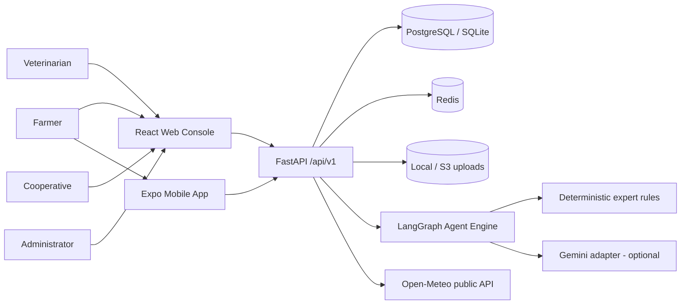
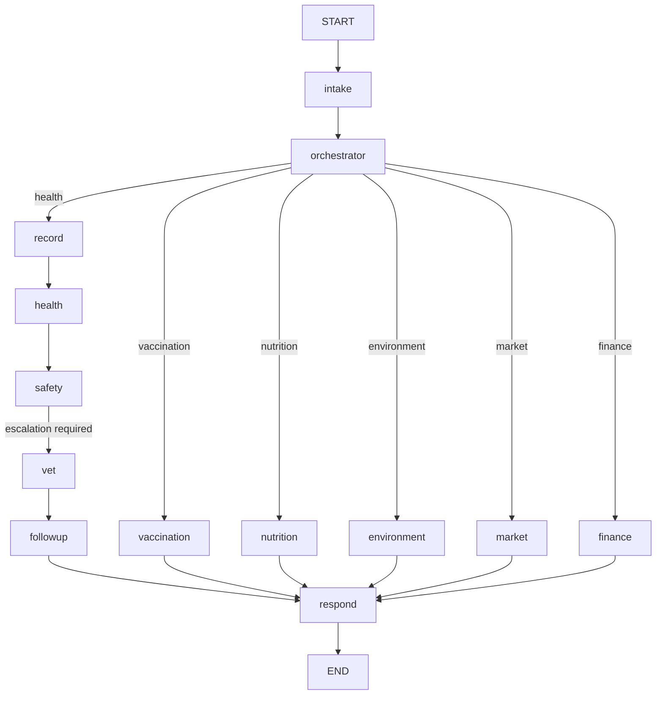

# Architecture

## System context

The same REST API and database serve both clients. The web console is a Vite single-page app; the mobile client is an Expo app with a local SQLite queue.

## Backend layering

| Layer | Location | Responsibility |
|---|---|---|
| API routers | `backend/app/api/v1/` | HTTP contracts, validation, authorization, pagination |
| Domain services | `backend/app/services/` | Access scoping, triage, vaccination, weather, finance, analytics, storage, notifications, LLM adapter |
| Agent engine | `backend/app/agents/` | LangGraph state graph, intake/orchestrator, clinical and advisory nodes, response composition |
| Models | `backend/app/models/` | 29 normalized SQLAlchemy tables with UUID keys, FKs, indexes and timestamps |
| Schemas | `backend/app/schemas/` | Pydantic v2 request/response contracts, generic `Page[T]` |
| Core | `backend/app/core/` | Settings, DB session, JWT/security, RBAC dependencies, errors, middleware, audit, constants |
| Seed | `backend/app/seed/demo.py` | Idempotent, clearly-marked demonstration dataset |

## Agent workflow

`GuardianState` carries the runtime database session and authenticated user, conversation context, a plan queue, a trace, additive `agents_used` and `safety_events`. The orchestrator combines grounded text extraction and explicit observation chips; health-report context forces the clinical plan. Missing animal context still runs urgency assessment but cannot create a case. Provider structures undergo strict validation and output scanning, with at most two transient attempts; invalid or ungrounded structures fall back to rules. `respond` screens localized output and retains emergency guidance when blocked. Workflow events are persisted in interactions and attributed audits after flushing an interaction ID. No checkpointer is used; sync calls flush without committing so the caller owns the savepoint transaction.

### Agent responsibilities (implemented nodes)

| Agent | Node | Key behaviour |
|---|---|---|
| Central orchestrator | `intake`, `orchestrator` | Intent classification, language detection, symptom structuring, plan selection |
| Animal record management | `record` | Resolves the animal by id/name/tag, loads vaccination and case history |
| Animal health monitoring | `health` | Multilingual symptom lexicon, conservative triage rules, case creation, escalation |
| Safety and approval | `safety` | Creates a pending `agent_approval` when veterinary review is required, blocks treatment records |
| Veterinary coordination | `vet` | Finds nearby verified vets, assigns a case, creates a visit request, notifies |
| Follow-up and notification | `followup` | Schedules a follow-up reminder and localized notifications |
| Vaccination management | `vaccination` | Ensures the verified schedule, surfaces due/overdue, creates reminders |
| Nutrition | `nutrition` | Feed/water history, species profile, missing-data gaps |
| Environmental monitoring | `environment` | Live weather plus recorded observations and threshold flags |
| Market intelligence | `market` | Latest district prices with source/date, demo labels preserved |
| Financial impact | `finance` | Production-derived revenue, expenses, estimated loss with assumptions |

## Authentication and authorization

- JWT bearer tokens (HS256, issuer `ai-livestock-guardian`), bcrypt password hashes. Tokens carry a `tv` (token version) claim and require `exp`/`sub`/`iat`; default lifetime is 2 hours.
- `require_roles(...)` enforces role gates; service-level query scoping isolates farmer data.
- Farmers see only their farms; veterinarians see only assigned cases; cooperatives see **active** (consented) members; administrators see all.
- Every mutating action calls `record_audit`. Rate limiting and security headers are applied by middleware.
- Uploads are validated by content type, size and Pillow decode, then re-encoded to strip EXIF and resized.

Batch B authorization model:

- **Verified professionals.** `require_verified_professional` (`app/services/access.py`) gates clinical assessment, record creation, approval decisions and vaccine verification. An unverified vet/paravet is rejected (403); changing registration number/qualification resets `verified=False`. Admin keeps verification and clinical-write authority.
- **Consent-based membership.** Cooperative invites create `pending` memberships with no data access; the farmer accepts/declines via `/users/cooperative/invitations`. Accept records `consented_at` and activates access. All cooperative scoping (records, analytics, appointments) uses active memberships only.
- **Object consistency.** Clinical records validate that a linked case belongs to the same accessible animal (422 `animal_case_mismatch`); sync applies the same check.
- **Scoped analytics/finance.** Cooperative and farm-less accounts see empty (not global) metrics; vet trends count assigned cases; vet milk/loss finance follows the accessible-animal scope.
- **Token invalidation.** Password change/admin reset bumps `users.token_version`; the dependency rejects tokens whose `tv` no longer matches (401 `token_revoked`). Change-password returns a fresh token; self-profile PATCH cannot change the password.

## Offline-first synchronization

1. Mobile writes operations to Expo SQLite with a client UUID and idempotency key. Every local data table (pending operations, pending photos, cached animals/schedule/cases) carries an `owner_id`; reads and writes are scoped to the active account.
2. `POST /sync/batch` processes each operation in a nested savepoint.
3. Replayed idempotency keys return `duplicate`; stale updates return `conflict`; failures return `error` without aborting the batch.
4. Applied operations are recorded in `sync_operations` for audit and administration.
5. Mobile queues health observations (not a clinically validated local case); it retains the selected language. On sync the server executes the same health/safety/vet/follow-up graph, preserves the observation UUID/time, re-triages an existing case without reducing urgency, and does not overwrite professional assessments. Pending visit requests are reused; no appointment time is auto-confirmed.
6. Sync enforces the canonical per-entity roles and validates payloads with the same typed schemas as the online routes (Batch B); non-animal `update` operations and out-of-range values become per-operation errors.

Mobile account ownership (Batch B, H07): login sets the active account, logout clears that account's cached/queued data and pending count, and switching accounts isolates each account's queue. Legacy rows without an `owner_id` are purged on upgrade because they cannot be attributed. This is proven through a Node `node:sqlite` adapter test, **not** a native device.

Batch C remains necessary: conflict replay, global idempotency ownership (binding keys to user/payload), queue chunking to the server limit, retry identity across online/offline, malformed-UUID batch isolation and durable photo upload/failure visibility are not resolved by Batch B role/schema parity or the shared health workflow.

## External integrations

| Integration | Mode |
|---|---|
| Gemini | Optional; intent, symptom extraction and translation only. Falls back to deterministic rules. |
| Open-Meteo | Live public API for farm weather; cached 10 minutes and gracefully unavailable. |
| Market prices | Demonstration rows marked `is_demo` with source and observation date. No invented live prices. |
| SMS / WhatsApp / push | Adapter boundary implemented; messages stay `pending` until a provider is configured. Never reported as delivered. |
| Storage | Local filesystem by default; S3-compatible deployment adapter boundary. |

## Deployment topology

- Docker Compose: PostgreSQL + Redis + API + nginx-served web build.
- Render: API container + managed PostgreSQL via `render.yaml`.
- Vercel: static web build with `VITE_API_URL`.
- Neon: managed PostgreSQL; run `alembic upgrade head` before serving.

Schema migrations are additive and applied via Alembic (`backend/alembic/versions/`). Batch B adds `b7c2d4e6f8a1` (`users.token_version`, `cooperative_memberships.consented_at`); existing databases must be upgraded, since `Base.metadata.create_all` only creates missing tables on fresh databases.

## Responsible AI

Policy forbids AI diagnoses, prescriptions, dosages and invented professional approval. Deterministic triage uses conservative monotonic urgency rules, clause-local negation and English/Hindi/Marathi warning phrases. Unclear reports require veterinary review. Rule thresholds are marked **needs vet review**; clinical accuracy is not established. Provider structures, localized response text and translations (including missing-provider echoes) are screened; blocks persist stage/reason without unsafe text and preserve escalation. Rule-based screening is not proof that all possible unsafe phrasings are caught. Batch B closed the audited professional-verification, consent, scoping and token-invalidation authorization defects (H01-H07, M02, M03); clinical validation and Batch C offline integrity remain open. Financial and market outputs expose provenance and limitations; all demonstration data is flagged.
